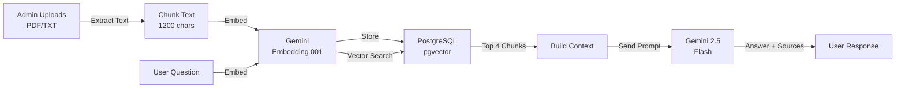

# morphos-core

**A hyper-variablized, domain-agnostic marketplace and booking engine that instantly morphs to any brand identity.**

Morphos Core dynamically adapts its brand identity, database schemas, and AI-powered capabilities through simple environment variable configuration. No code changes required—transform from one industry vertical to another with a single deployment.

## 🎯 Key Features

- **Domain-Agnostic Architecture**: One codebase powers multiple marketplace verticals (services, rentals, bookings, beauty & wellness, etc.)
- **Environment-Driven Configuration**: Morph brand identity, AI behavior via environment variables—no code changes
- **Gemini-Powered RAG AI Chatbot**: Intelligent conversational agent with knowledge retrieval and fact grounding
- **MCP (Model Context Protocol) Ready**: Expose skills/capabilities for external AI orchestration
- **Vector Similarity Search**: PostgreSQL `pgvector` for semantic search over uploaded knowledge
- **Serverless-First**: Zero-cost deployment on Vercel (Next.js frontend + FastAPI API on same domain)
- **Modern Tech Stack**: Next.js, FastAPI, Supabase PostgreSQL, Google Gemini AI

## 🏗️ Tech Stack

| Component | Technology | Purpose |
|-----------|-----------|---------|
| **Frontend** | Next.js + TypeScript | Responsive marketplace UI with chat widget |
| **Backend** | FastAPI + Python | Serverless API (Vercel Functions) |
| **Database** | Supabase PostgreSQL | `pgvector` extension for embeddings, JSONB for flexible schemas |
| **AI Models** | Google Gemini 2.5 Flash | Response generation; Gemini Embedding 001 for vectorization |
| **Auth** | Supabase Auth | Admin dashboard access |
| **Storage** | Supabase Storage | Knowledge documents (PDF/TXT/Markdown) |
| **DevOps** | GitHub Actions | Auto-deploy migrations + Vercel projects on push |

## 🚀 Quick Start

### 1. Prerequisites

- GitHub account
- Vercel account (free)
- Supabase account (free)
- Google Gemini API key ([get here](https://aistudio.google.com/))

### 2. Clone & Setup

```bash
git clone https://github.com/E-Vanika/morphos-core.git
cd morphos-core
```

### 3. Configure GitHub Secrets

Go to **GitHub** → **Your Repository** → **Settings** → **Secrets and variables** → **Actions** and add:

| Secret Name | Value | Where to Find |
|---|---|---|
| `VERCEL_TOKEN` | Vercel auth token | [Vercel Settings → Tokens](https://vercel.com/account/tokens) |
| `SUPABASE_ACCESS_TOKEN` | Supabase access token | Supabase Dashboard → Account → Access Tokens |
| `SUPABASE_PROJECT_REF` | Project reference ID | Supabase → Settings → General → Reference ID |
| `SUPABASE_DB_PASSWORD` | Database password | *You set this during Supabase project creation* |
| `SUPABASE_URL` | Project URL | Supabase → Settings → API → Project URL |
| `SUPABASE_ANON_KEY` | Anon/public key | Supabase → Settings → API → anon key |
| `SUPABASE_SERVICE_ROLE_KEY` | Service role key | Supabase → Settings → API → service_role key |
| `GEMINI_API_KEY` | Google Gemini API key | [Google AI Studio](https://aistudio.google.com/) → Get API Key |
| `MCP_API_KEY` | Random 32+ char string | Generate: `openssl rand -hex 16` |
| `ADMIN_EMAILS` | Comma-separated emails | Emails allowed to manage knowledge & services |

**Example:**
```
VERCEL_TOKEN=kv_xxxxxxxxxxxxxxxx
SUPABASE_URL=https://xxxxx.supabase.co
GEMINI_API_KEY=AIzaSyxxxxxxx
MCP_API_KEY=abc123def456ghi789jkl
ADMIN_EMAILS=admin@example.com,you@example.com
```

### 4. Deploy

Push to `main` branch. GitHub Actions will:
1. Apply Supabase migrations (database schema + pgvector setup)
2. Create/update Vercel projects
3. Deploy frontend + API

```bash
git push origin main
# Check: GitHub → Actions to monitor deployment
```

### 5. Test

- **Frontend**: `https://your-project.vercel.app`
- **API Health**: `https://your-project.vercel.app/api/health` → should return `{"status":"ok"}`
- **Chat Widget**: Available at bottom-right of the site

---

## 🧠 How RAG + Gemini AI Works

### RAG (Retrieval-Augmented Generation) Pipeline

1. **Upload Knowledge** (PDF/TXT/Markdown)
   - Admin uploads via `/api/v1/admin/documents`
   - System chunks text (1200 chars per chunk, 1000 char overlap)
   - Each chunk is embedded using **Gemini Embedding 001** → 768-dimensional vector
   - Vectors stored in `knowledge_chunks` table with `pgvector` extension

2. **User Asks Question**
   - Message sent to `/api/v1/chat` endpoint
   - Question is embedded using same Gemini model

3. **Vector Similarity Search**
   - PostgreSQL `pgvector` finds top 4 most similar chunks
   - Uses `<=>` operator for efficient cosine distance
   - Formula: `1 - (embedding1 <=> embedding2)` = similarity score

4. **Generate Answer with Context**
   - System prompt + retrieved chunks + user question sent to **Gemini 2.5 Flash**
   - AI generates answer grounded only in provided knowledge
   - Response includes source filenames



### System Prompts by Domain

Each domain has a custom system prompt to ensure quality responses:

```python
# apps/api/app/domain.py
PROFILES = {
    "bridal-makeup": DomainProfile(
        name="Bridal makeup",
        assistant_name="Monika Glam Up assistant",
        system_prompt="You help visitors understand bridal makeup and hairstyling..."
    ),
    "art-craft": DomainProfile(
        name="Art and craft",
        assistant_name="Crafts by Vani assistant",
        system_prompt="You help visitors understand custom art orders..."
    ),
    # Add more domains here
}
```

---

## 🔌 MCP (Model Context Protocol)

### What is MCP?

MCP is a standardized protocol for AI systems to discover and use external tools/skills. In Morphos:

- **Endpoint**: `GET /api/v1/skills`
- **Authentication**: `X-MCP-Key` header
- **Returns**: List of available agent capabilities

### Example Usage

```bash
curl -H "X-MCP-Key: your-mcp-api-key" \
  https://your-site.vercel.app/api/v1/skills
```

**Response:**
```json
[
  {
    "id": "search_providers",
    "description": "Find providers by specialty, expertise, or keyword.",
    "input_hint": "query: string"
  },
  {
    "id": "check_availability",
    "description": "Find open appointment slots for a provider.",
    "input_hint": "provider_id: string, date_range: string"
  },
  {
    "id": "create_booking_draft",
    "description": "Prepare, but never finalize, a booking from confirmed details.",
    "input_hint": "provider_id: string, slot: string"
  }
]
```

**Note**: Currently, these are skill definitions. To fully implement skill execution, you'd need to:
1. Extend Gemini to use `tools` parameter for function calling
2. Implement actual skill endpoints (e.g., `POST /api/v1/skills/search_providers`)

---

## 📊 Architecture & Data Flow

```
┌─────────────────────────────────────────────────────────────┐
│ FRONTEND (Vercel - Next.js)                                 │
│ ├─ pages/                  (Landing, brand-specific UI)      │
│ └─ components/chat-widget  (AI chatbot interface)            │
└──────────────────┬──────────────────────────────────────────┘
                   │ HTTP/HTTPS
                   ↓
┌─────────────────────────────────────────────────────────────┐
│ BACKEND (Vercel Functions - FastAPI)                        │
│ ├─ /api/v1/chat              (RAG chat)                     │
│ ├─ /api/v1/skills            (MCP endpoint)                 │
│ ├─ /api/v1/admin/documents   (Upload knowledge)             │
│ ├─ /api/v1/services          (Marketplace items)            │
│ └─ /api/v1/orders            (Booking requests)             │
└──────────────────┬──────────────────────────────────────────┘
                   │
        ┌──────────┴──────────┬──────────────┐
        ↓                     ↓              ↓
    ┌──────────┐      ┌─────────────┐  ┌──────────┐
    │ Supabase │      │   Gemini    │  │ Gemini   │
    │PostgreSQL│      │ Embedding   │  │  Chat    │
    │ pgvector │      │   001       │  │2.5 Flash │
    │ Storage  │      └─────────────┘  └──────────┘
    └──────────┘
```

### Database Schema

```sql
-- Vector embeddings for knowledge base
knowledge_documents     -- Admin-uploaded files (PDF, TXT, MD)
├── id (uuid)
├── domain_id (text)    -- Which vertical (bridal-makeup, art-craft)
├── filename (text)     -- Source name shown in response
└── storage_path (text) -- Supabase storage location

knowledge_chunks        -- Text segments with embeddings
├── id (uuid)
├── document_id (uuid)  -- Reference to document
├── content (text)      -- Chunk text (1200 chars)
└── embedding (vector)  -- 768-dim Gemini embedding

-- Custom RPC function for vector similarity
match_knowledge_chunks(query_embedding, match_count)
└─ Finds top N most similar chunks using pgvector
```

---

## 🚀 Deployment Architecture

### How It Works

1. **GitHub Action Trigger**: Push to `main` branch
2. **Supabase Migrations**: Automatic schema updates (includes `pgvector` setup)
3. **Vercel Deployment**: Build & deploy both Next.js + FastAPI
4. **API Routes**: Both served on same domain under `/api`

```bash
# Vercel builds with this config (vercel.json):
{
  "framework": "nextjs",
  "outputDirectory": "apps/web/.next",
  "functions": {
    "api/index.py": {
      "maxDuration": 60  # Seconds
    }
  }
}
```

### Environment Variables at Runtime

Vercel uses GitHub Secrets → Sets `--build-env` and `--env` during deployment

```bash
npx vercel deploy --prod \
  --build-env GEMINI_API_KEY=${{ secrets.GEMINI_API_KEY }} \
  --build-env SUPABASE_SERVICE_ROLE_KEY=${{ secrets.SUPABASE_SERVICE_ROLE_KEY }}
```

---

## 💡 Use Cases

| Vertical | Example | Domain | Assistant Name |
|----------|---------|--------|---|
| **Beauty & Wellness** | Bridal makeup, salon | `bridal-makeup` | Monika Glam Up assistant |
| **Creative Services** | Art, custom orders | `art-craft` | Crafts by Vani assistant |
| **Professional Services** | Consulting, coaching | `professional-services` | Clarity concierge |
| **Healthcare** | Doctor appointments | `healthcare` | Care concierge |
| **Custom Vertical** | Your industry | `your-domain` | Your AI name |

Add new verticals by extending `PROFILES` in `apps/api/app/domain.py`

---

## 🔐 Security & Best Practices

| Aspect | Implementation |
|--------|---|
| **API Keys** | GitHub Secrets (never in repo) |
| **Database Access** | Supabase Service Role Key (backend only) |
| **Admin Auth** | Supabase JWT tokens + email whitelist |
| **Rate Limiting** | 12 requests per 60 seconds per IP |
| **CORS** | Configurable `ALLOWED_ORIGINS` |
| **Knowledge Isolation** | Documents scoped to domain/admin |
| **System Prompts** | Prevent prompt injection via domain-specific rules |

---

## 📝 Local Development

### Option 1: Full Stack with Vercel CLI

```bash
# Install Vercel CLI
npm i -g vercel

# Link to Vercel project
vercel link

# Start local dev (includes FastAPI serverless simulation)
vercel dev

# Access: http://localhost:3000
```

### Option 2: Manual Setup (Frontend + Backend Separate)

```bash
# Terminal 1: Frontend
cd apps/web
npm install
npm run dev
# → http://localhost:3000

# Terminal 2: Backend
cd apps/api
pip install -r requirements.txt
python -m uvicorn app.main:app --reload --host 0.0.0.0 --port 8000
# → http://localhost:8000

# Set in apps/web/.env.local:
NEXT_PUBLIC_API_URL=http://localhost:8000/api
```

### Environment Variables for Local Dev

Create `apps/web/.env.local`:
```env
NEXT_PUBLIC_API_URL=http://localhost:8000/api
NEXT_PUBLIC_SITE_KIND=bridal  # or craft
```

Create `apps/api/.env.local`:
```env
SUPABASE_URL=https://xxxxx.supabase.co
SUPABASE_SERVICE_ROLE_KEY=eyJhbGc...
GEMINI_API_KEY=AIzaSy...
MCP_API_KEY=your-random-key
ADMIN_EMAILS=you@example.com
ALLOWED_ORIGINS=http://localhost:3000
```

---

## ❓ FAQ

### **AI Assistant Says "Offline" or "Temporarily Offline"**

**Causes & Solutions:**

1. **Gemini API Key Missing**
   - Check: GitHub Secrets → `GEMINI_API_KEY` is set
   - Verify: Key is valid at [Google AI Studio](https://aistudio.google.com/)
   - Test: `curl "https://your-api.vercel.app/api/health"` → should return `{"status":"ok"}`

2. **API Not Responding**
   - Check: Vercel deployment logs for errors
   - Verify: `SUPABASE_URL` and `SUPABASE_SERVICE_ROLE_KEY` are set in GitHub Secrets
   - Test locally: Run backend on `localhost:8000` and set `NEXT_PUBLIC_API_URL=http://localhost:8000/api`

3. **Rate Limit Exceeded**
   - Limit: 12 requests per 60 seconds per IP
   - Solution: Wait 60 seconds before retrying
   - For production: Use Vercel's WAF or API Gateway limits

4. **CORS Issues**
   - Add your domain to `ALLOWED_ORIGINS` GitHub Secret
   - Local dev: Ensure it includes `http://localhost:3000`

### **How Do I Add Knowledge?**

1. Prepare document (PDF, TXT, or Markdown)
2. Create Supabase Auth account (for admin)
3. Add your email to `ADMIN_EMAILS` GitHub Secret
4. Sign in at your site with that email
5. Use `/api/v1/admin/documents` endpoint with `Authorization: Bearer <your_supabase_token>`

**Example:**
```bash
curl -X POST https://your-site.vercel.app/api/v1/admin/documents \
  -H "Authorization: Bearer YOUR_SUPABASE_TOKEN" \
  -F "file=@pricing.pdf"
```

### **Can I Use a Different AI Model?**

Gemini is baked in. To use OpenAI/Anthropic:
1. Replace `google-genai` imports with your provider's SDK
2. Update embedding model (keep 768-dim for pgvector)
3. Update `generate_content()` call to your provider's API
4. Test vector similarity search still works

### **How Do I Deploy to a Different Cloud?**

Currently optimized for **Vercel** (zero-cost, easy GitHub integration).

To use AWS Lambda/GCP Cloud Functions:
1. Keep FastAPI backend code the same
2. Create serverless function wrapper (e.g., AWS SAM, Google Cloud Functions)
3. Deploy frontend to different CDN (CloudFront, Cloud CDN, etc.)
4. Update API endpoint in frontend env vars

### **Can I Customize the Domain Profiles?**

Yes! Edit `apps/api/app/domain.py`:

```python
PROFILES = {
    "your-domain": DomainProfile(
        name="Your Business",
        listing_label="offerings",
        booking_label="booking",
        assistant_name="Your AI Name",
        system_prompt="Your custom system prompt here...",
    ),
}
```

Then use `domain: "your-domain"` in chat requests.

### **How Is Knowledge Stored & Searched?**

- **Chunking**: Text split into 1200-char pieces (1000-char overlap for context)
- **Embedding**: Each chunk vectorized with Gemini Embedding 001 (768 dimensions)
- **Storage**: PostgreSQL `knowledge_chunks` table with `pgvector` extension
- **Search**: Similarity search uses `<=>` operator (cosine distance)
- **Top Results**: Top 4 most similar chunks sent to LLM with user question

### **Why PostgreSQL pgvector Instead of Vector DB?**

- **Simplicity**: Everything in Supabase (single DB)
- **Cost**: No separate Vector DB subscription
- **Speed**: pgvector optimized for <1M vectors (sufficient for typical knowledge bases)
- **SQL**: Combine vector search with traditional SQL filters
- **Scaling**: Simple to migrate to dedicated vector DB later if needed

### **What Happens if Knowledge Is Too Large?**

- Max file size: 5 MB (configurable in code)
- Max text per chunk: 1200 characters
- Typical limit: ~200-300 files before vector search slows down
- Solution: Use Pinecone/Weaviate for enterprise-scale RAG

### **Can I Use This with Multiple Websites?**

Yes! Each GitHub Secret set can deploy multiple Vercel projects:

```bash
# deploy.yml workflow deploys TWO sites:
deploy_site crafts-by-vani craft      # Uses NEXT_PUBLIC_SITE_KIND=craft
deploy_site monika-glamup bridal      # Uses NEXT_PUBLIC_SITE_KIND=bridal
```

Each gets its own domain + database scope.

### **Is This Production-Ready?**

✅ **Yes, for small-to-medium projects:**
- Suitable for: <10k monthly users, <500 documents
- RAG performance: Milliseconds (pgvector is fast)
- API rate limiting: Built-in, but scale with Vercel Edge Middleware for enterprise
- Zero-cost hosting: Free tier Supabase + Vercel covers most use cases

⚠️ **Consider enterprise solutions if you need:**
- > 1M vectors
- Real-time collaborative editing
- Multi-region deployments
- 99.99% uptime SLAs
- Custom model fine-tuning

---

## 📂 File Structure

```
morphos-core/
├── apps/
│   ├── web/                    # Next.js frontend
│   │   ├── app/
│   │   │   ├── page.tsx       # Landing page (brand-specific)
│   │   │   ├── layout.tsx     # App shell
│   │   │   ├── globals.css    # Styles
│   │   │   └── components/
│   │   │       └── chat-widget.tsx  # AI chat UI
│   │   ├── package.json
│   │   └── tsconfig.json
│   └── api/
│       ├── app/
│       │   ├── main.py        # FastAPI app + endpoints
│       │   ├── domain.py      # Domain profiles & system prompts
│       │   └── skills.py      # MCP skill definitions
│       ├── requirements.txt    # Python dependencies
│       └── .env.example
├── api/
│   └── index.py               # Vercel serverless wrapper
├── supabase/
│   └── migrations/
│       ├── 202607190001_initial.sql           # Tables + pgvector setup
│       ├── 202607230002_order_requests.sql
│       ├── 202607230003_services.sql
│       └── 202607230004_knowledge_sources.sql # RAG vectors
├── .github/
│   └── workflows/
│       ├── ci.yml            # Linting & tests
│       └── deploy.yml        # Auto-deploy on push
├── vercel.json               # Deployment config
├── package.json              # Root workspace config
└── README.md                 # This file
```

---

## 🛠️ Troubleshooting

### **Deployment Fails: "GEMINI_API_KEY not set"**

- **Check**: GitHub Secrets → Actions → Verify `GEMINI_API_KEY` is added
- **Verify**: Value is actual API key (starts with `AIzaSy...`)
- **Retry**: Re-run GitHub Action workflow

### **Chat Returns: "Database connection failed"**

- **Check**: `SUPABASE_SERVICE_ROLE_KEY` in GitHub Secrets
- **Verify**: Key is the "service_role" key (not anon key)
- **Test**: Run migrations manually: `Supabase Dashboard → SQL Editor` → paste migrations

### **Vector Search Returns No Results**

- **Check**: Knowledge has been uploaded via `/api/v1/admin/documents`
- **Verify**: Admin user email is in `ADMIN_EMAILS`
- **Test**: Check Supabase `knowledge_chunks` table → should have rows with embeddings

### **Vercel Function Timeout (>60s)**

- **Cause**: Large file processing or slow API calls
- **Solution**: Increase `maxDuration` in `vercel.json` (up to 900s on Pro plan)
- **Alternative**: Offload to background job service

---

## 📚 Additional Resources

- [Supabase Docs](https://supabase.com/docs)
- [pgvector Documentation](https://github.com/pgvector/pgvector)
- [Google Gemini API](https://ai.google.dev/)
- [Vercel Deployment](https://vercel.com/docs)
- [Model Context Protocol Spec](https://modelcontextprotocol.io/)

---

## 📝 Project Showcase

**Current Deployments:**
- **Crafts by Vani**: Art & custom craft orders (domain: `art-craft`)
- **Monika Glam Up**: Bridal makeup & hairstyling (domain: `bridal-makeup`)
- Fully responsive design with mobile support
- Real-time availability updates
- One-click booking confirmation

## 🛠️ Development Workflow

1. **Create a branch** for your feature
2. **Push changes** → GitHub Actions auto-tests
3. **Deploy preview** via Terraform Cloud
4. **Merge to main** → Production deployment

## 📚 Documentation

- [Setup Guide](./docs/SETUP.md)
- [API Reference](./docs/API.md)
- [Domain Configuration](./docs/CONFIGURATION.md)
- [Deployment Guide](./docs/DEPLOYMENT.md)

## 🤝 Contributing

Contributions welcome! Please:
1. Fork the repository
2. Create a feature branch
3. Submit a pull request with detailed description

## 📄 License

[Add your license here]

## 🙋 Support

For questions or issues:
- Open a GitHub issue
- Check existing discussions
- Review the documentation

---

**Built with ❤️ by the Morphos team**
