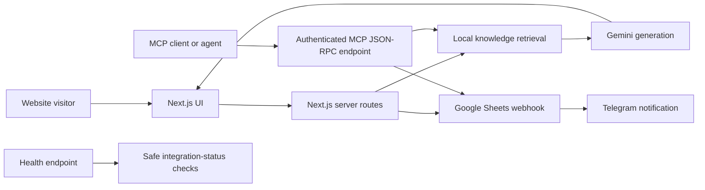

# Monika Glam Up

A professional bridal and self-care website with transparent pricing, a portfolio, an AI concierge, private enquiries, public client reviews, Google Sheets storage, optional Telegram alerts, and MCP tools.

## What you still need to do

- [ ] Replace your Apps Script project code with [the current script](docs/google-sheets-apps-script.gs).
- [ ] In Apps Script, choose **Deploy → Manage deployments → Edit → New version → Deploy**. Editing code alone does not update the live webhook.
- [ ] Push this repository to `main` and wait for both Vercel deployments to finish.
- [ ] Open `/api/health` on the Monika domain and confirm `google_sheets`, `gemini`, `telegram`, and `mcp` are all `true`.
- [ ] Submit one test enquiry and confirm that it appears in the Sheet's `Enquiries` tab.
- [ ] Submit one test review and confirm that it appears immediately on `/reviews`. No approval step is required.
- [ ] Ask the concierge one question and confirm a useful answer appears.

All listed secrets have already been added according to the project handoff. Do not commit their values to this repository.

## Included pages and features

- Monika Glam Up bridal home page with the supplied services and prices
- Full rating summary, rating distribution, and every client comment at `/reviews`
- Mamo Self Care menu, combos, transparent pricing, and private enquiry form at `/mamo-self-care`
- Gemini-powered concierge grounded in the published service guide
- Built-in answers for common service questions when the AI provider is briefly unavailable
- Google Sheets as the operational store for enquiries and reviews
- Optional Telegram alert after an enquiry is safely stored
- MCP service-menu, concierge, and enquiry tools

The public APIs and MCP endpoint are native Next.js route handlers inside `apps/web`, so they work when Vercel's Root Directory is `apps/web`. Supabase is not required for the production customer journey. The legacy FastAPI implementation remains as a compatibility/reference path.

## Engineering case study

This project demonstrates more than frontend development. It combines a production-oriented AI workflow, MCP tools, serverless integrations, failure isolation, and operational diagnostics in a small-business application.

### Architecture



### AI and RAG implementation

The production concierge uses a lightweight retrieval-augmented generation pipeline. It is not described as vector search because the deployed retrieval method is deterministic weighted lexical retrieval.

| RAG stage | Implementation |
|---|---|
| Knowledge preparation | Supplied business documents are converted into small, version-controlled knowledge chunks with titles, content, and retrieval keywords. |
| Retrieval | The visitor query is tokenised and scored against titles, keywords, and chunk content. The top relevant chunks are selected. |
| Augmentation | Only retrieved chunks are placed in the Gemini prompt alongside booking-safety and prompt-injection constraints. |
| Generation | Gemini `2.5-flash` generates the customer-facing response from retrieved context. |
| Grounding | The API returns the titles of retrieved sources and the chat interface displays them beneath the response. |
| Degradation | If Gemini is missing, slow, or unavailable, deterministic service-guide answers keep core questions usable. |

Relevant implementation:

- [Knowledge corpus and retriever](apps/web/lib/knowledge.ts)
- [Gemini, Sheets, and Telegram integrations](apps/web/lib/server-integrations.ts)
- [Chat API route](apps/web/app/api/v1/chat/route.ts)
- [Concierge interface](apps/web/app/components/chat-widget.tsx)
- [Retrieval unit tests](apps/web/lib/knowledge.test.ts)

The legacy FastAPI path also contains an optional Gemini-embedding/Supabase RPC retrieval implementation. The deployed Next.js path deliberately does not depend on Supabase because that database was not reliable for this project.

### MCP and agent integration

`POST /api/mcp` exposes an API-key-protected JSON-RPC tool surface that allows an agent to:

- retrieve the published bridal service menu;
- ask the RAG-backed bridal concierge;
- save a private enquiry and trigger the notification workflow.

Tool calls never confirm availability. The enquiry tool stores the request before attempting the optional Telegram notification.

### SRE and reliability decisions

| Reliability concern | Control used here |
|---|---|
| Deployment health | `/api/health` reports service status and safe booleans for Sheets, Gemini, and Telegram configuration without exposing secret values. |
| Dependency hangs | Google Sheets, Telegram, and Gemini calls use explicit 10–20 second timeouts. |
| Data before notification | Enquiries are written to Google Sheets before Telegram is called. A Telegram failure cannot discard a saved lead. |
| Failure isolation | Reviews, enquiries, AI, and Telegram errors are handled independently with actionable server logs. |
| Graceful degradation | The concierge falls back to deterministic grounded answers when Gemini fails. |
| Input boundaries | Server routes validate required fields, lengths, integer ratings, and supported operations. |
| Secret handling | Gemini, MCP, Telegram, and webhook credentials remain server-side environment variables. |
| MCP authentication | `X-MCP-Key` comparison uses a timing-safe equality check. |
| Supply-chain control | The required `esbuild` install script is allowed only for the exact pinned version. |
| Monorepo deployment | Both repository-root and `apps/web` Vercel build layouts are supported. |

### Engineering skills demonstrated

- Next.js App Router, React, TypeScript, responsive and accessible UI
- FastAPI and Pydantic reference implementation
- RAG retrieval, prompt grounding, source attribution, and deterministic fallback
- Gemini REST integration and prompt-injection boundaries
- MCP tool schemas and JSON-RPC handling
- Google Apps Script webhooks and spreadsheet-backed workflows
- Telegram Bot API integration
- Health checks, timeouts, failure isolation, safe configuration diagnostics, and CI/CD

### Production hardening backlog

The following are intentionally documented rather than claimed as completed:

- durable rate limiting for public serverless endpoints;
- idempotency keys to prevent duplicate enquiry submissions;
- retry/dead-letter handling for failed Telegram notifications;
- automated browser and integration tests in CI;
- external uptime checks and alerting;
- vector retrieval if the knowledge corpus grows beyond the current curated guide.

## Google Sheets setup

Google Sheets is the source of truth for enquiries and reviews.

1. Open [script.google.com](https://script.google.com) and open the Apps Script project connected to your Sheet.
2. Paste [docs/google-sheets-apps-script.gs](docs/google-sheets-apps-script.gs).
3. In **Project Settings → Script properties**, set:

   ```text
   WEBHOOK_KEY = a-long-random-secret
   SPREADSHEET_ID = 1GKPFoW9c1pzrPQQDd228Rc45m7FCaKwQyR0c22PtYX0
   ```

4. Run `setupSheets` once and approve access.
5. Choose **Deploy → Manage deployments → Edit → New version → Deploy**.
6. Copy the `/exec` deployment URL and append the same key:

   ```text
   https://script.google.com/macros/s/DEPLOYMENT_ID/exec?key=YOUR_WEBHOOK_KEY
   ```

7. Save that complete URL as `GOOGLE_SHEETS_WEBHOOK_URL` in GitHub Actions and Vercel.

The script creates `Enquiries` and `Reviews` tabs. Reviews are public immediately. The old `Approved` column remains for backward compatibility but is no longer used as a filter.

## Environment variables

Required:

```env
GOOGLE_SHEETS_WEBHOOK_URL=https://script.google.com/macros/s/.../exec?key=...
GEMINI_API_KEY=...
MCP_API_KEY=...
NEXT_PUBLIC_INSTAGRAM_URL=https://www.instagram.com/monika_glamup/
```

Optional Telegram alerts:

```env
TELEGRAM_BOT_TOKEN=...
TELEGRAM_CHAT_ID=5907218590
```

Application defaults:

```env
NEXT_PUBLIC_API_URL=/api
ALLOWED_ORIGINS=http://localhost:3000
LOG_LEVEL=INFO
```

Monika Glam Up is the safe default. Only the Crafts project needs a brand variable:

| Vercel project | `NEXT_PUBLIC_SITE_KIND` |
|---|---|
| `monika-glamup` | Leave unset (defaults to `bridal`) |
| `crafts-by-vani` | `craft` |

The application safely defaults to `bridal` when the variable is missing. The GitHub workflow supplies `craft` only to Crafts by Vani. If Vercel Git Integration is enabled, add the same Crafts-only value under **Settings → Environment Variables** so automatic and workflow deployments behave identically.

### Canonical Vercel project settings

Both projects must deploy from the repository root. In **Settings → Build and Deployment**, use:

| Setting | Value |
|---|---|
| Root Directory | Leave blank (repository root) |
| Framework Preset | Next.js |
| Install Command | `npm install` |
| Build Command | `npm run build:web` |
| Output Directory | `apps/web/.next` |

Do not set Root Directory to `apps/web`; doing so makes Vercel look for `apps/web/apps/web/.next`.

## Local development

Requirements: Node.js 22+ and Python 3.12+.

```bash
npm install
python -m pip install -r requirements.txt
npx vercel dev
```

Build checks:

```bash
npm run build:web
python -m compileall apps/api/app api
```

The Vercel build runs from the repository root. The root `build:web` script builds the `@morphos/web` workspace and writes the result to `apps/web/.next`.

## Deployment checks

```bash
curl https://YOUR_DOMAIN/api/health

curl -X POST https://YOUR_DOMAIN/api/v1/orders \
  -H "Content-Type: application/json" \
  -d '{"service":"bridal-makeup","customer_name":"Test Bride","phone":"9876543210","requested_service":"Soft Glam Bridal Look"}'
```

Delete test rows from the Sheet afterward.

The GitHub workflow deploys:

- `monika-glamup` with the default bridal brand (no site-kind override)
- `crafts-by-vani` with `NEXT_PUBLIC_SITE_KIND=craft`

After each deployment, the workflow verifies the expected page title, brand favicon and `/api/health` site kind. A brand collision fails the workflow instead of publishing silently.

## API and MCP

| Method | Path | Purpose |
|---|---|---|
| `GET` | `/api/health` | Deployment health |
| `POST` | `/api/v1/chat` | AI concierge |
| `POST` | `/api/v1/orders` | Save an enquiry to Google Sheets |
| `GET` | `/api/v1/reviews` | Read all Sheet reviews |
| `POST` | `/api/v1/reviews` | Publish a review |
| `POST` | `/api/mcp` | MCP JSON-RPC endpoint |

MCP calls use `POST /api/mcp` with the header `X-MCP-Key: YOUR_MCP_KEY`. Available tools are `get_bridal_service_menu`, `ask_bridal_concierge`, and `prepare_bridal_enquiry`.

Inspect a grounded chat response and its retrieved sources:

```bash
curl -X POST https://YOUR_DOMAIN/api/v1/chat \
  -H "Content-Type: application/json" \
  -d '{"message":"Compare matte and glow bridal finishes"}'
```

Discover the MCP tools:

```bash
curl -X POST https://YOUR_DOMAIN/api/mcp \
  -H "Content-Type: application/json" \
  -H "X-MCP-Key: YOUR_MCP_KEY" \
  -d '{"jsonrpc":"2.0","id":1,"method":"tools/list"}'
```
